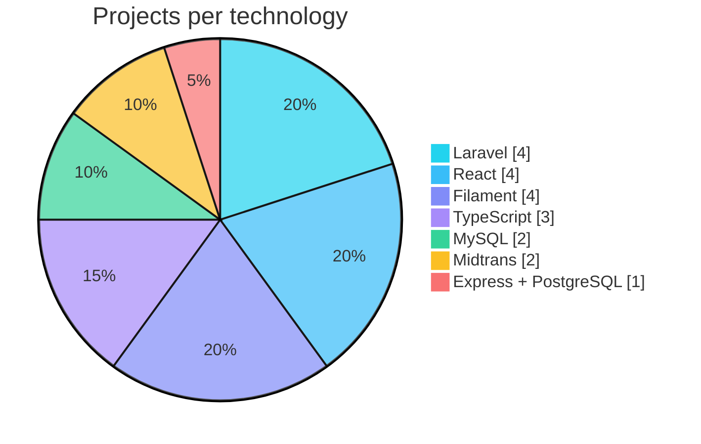

  
  
  

---

## 👨‍💻 About Me

- 🎓 Informatics Engineering student at **Universitas Pancasila**, Jakarta
- 📚 Writing my undergraduate thesis on an **interactive digital E-Library system** for Yayasan Pendidikan Umum Santo Lukas Jakarta
- 🛠️ Building full-stack web apps with **Laravel + Filament** on the backend and **React + TypeScript** on the frontend
- 🤖 Using AI-assisted development (vibe coding) with Claude and Gemini models to ship faster without skipping architecture
- 🧱 Comfortable with clean architecture: Model-Repository-Service pattern, RBAC, payment gateway integration, and CI/CD
- 🌱 Currently exploring microservices, Redis, n8n automation, and Flutter
- 🌐 Based in Jakarta, Indonesia · Communicates in Bahasa Indonesia and English

---

## 💼 Current Roles

| Role | Focus |
| --- | --- |
| 🎓 **Informatics Engineering Student** | Universitas Pancasila |
| 📖 **Thesis Researcher & Developer** | E-Library system (Laravel 12, React 19, Filament 5, Midtrans) |
| 💻 **Freelance Full-Stack Developer** | Company profile sites, LMS/CBT platforms, and custom web systems |

---

## 🧰 Tech Stack

<b>Languages & Frontend</b>

 

<b>Backend & Database</b>

 

<b>Tools & DevOps</b>

 

**Also working with:** Filament · Inertia.js · Shadcn UI · Framer Motion · Swiper.js · Midtrans · Sequelize · n8n · Gemini API · Antigravity · Laragon

### Technology usage across my featured projects

---

## 🚀 Featured Projects

 

<b>📚 E-Library Santo Lukas</b> · Thesis project

 

Digital library system built as the practical implementation of my thesis.
- Admin panel with Filament 5, role-based access for three actor types
- Book classification using Dewey Decimal (DDC) reference tables
- Loan and return management, Midtrans payment, large-PDF handling
- **Stack:** `Laravel 12` `React 19` `TypeScript` `Inertia.js` `Filament 5` `MySQL`
- **Repo:** [PerpustakaanSaintLuke](https://github.com/DioPrasetyo04/PerpustakaanSaintLuke)

<b>🎓 Online Course Platform</b>

 

Online course web app with Midtrans payment integration.
- **Stack:** `Laravel` `Filament` `TypeScript` `Midtrans`
- **Repo:** [Course-Online-With-Laravel-Fillament](https://github.com/DioPrasetyo04/Course-Online-With-Laravel-Fillament)

<b>🧪 LMS + Online CBT Platform</b> · In development

 

Multi-tenant learning and computer-based test platform with certificates, retakes, real-time chat, and notification automation.
- **Stack:** `Express.js` `React` `PostgreSQL` `Redis` `Microservices` `n8n` `Gemini API`

<b>🌐 Personal 3D Portfolio</b> · In development

 

Portfolio site with 3D components, dark/light theme, and three languages (EN, ID, ZH).
- **Stack:** `Laravel` `Filament` `React` `TypeScript` `Shadcn` `Swiper.js` `MySQL`

<b>🏭 Fiber Products Company Website</b> · In development

 

Company profile and product catalog for a water tank and septic tank manufacturer, with a Filament CMS supporting per-product dynamic content.
- **Stack:** `Laravel` `Filament` `React` `Tailwind CSS`

<b>🎓 Coursework Repositories</b>

 

Web programming practicals and final project: [`PrakPBW`](https://github.com/DioPrasetyo04/PrakPBW) · [`PRAKPBWA`](https://github.com/DioPrasetyo04/PRAKPBWA) · [`Prak-PBW-Pert.02`](https://github.com/DioPrasetyo04/Prak-PBW-Pert.02) · [`TUBES_PBW`](https://github.com/DioPrasetyo04/TUBES_PBW) · [`Flutter-Dasar`](https://github.com/DioPrasetyo04/Flutter-Dasar)

---

## 📊 GitHub Stats

---

## 📈 Contribution Graph

**Contribution calendar**

  

**Contribution activity (last 31 days)**

---

## 🏆 Achievements

---

## 📫 Let's Connect

  
  
  
  

